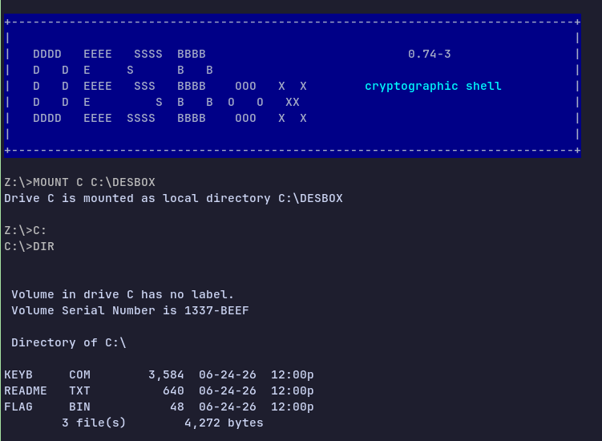
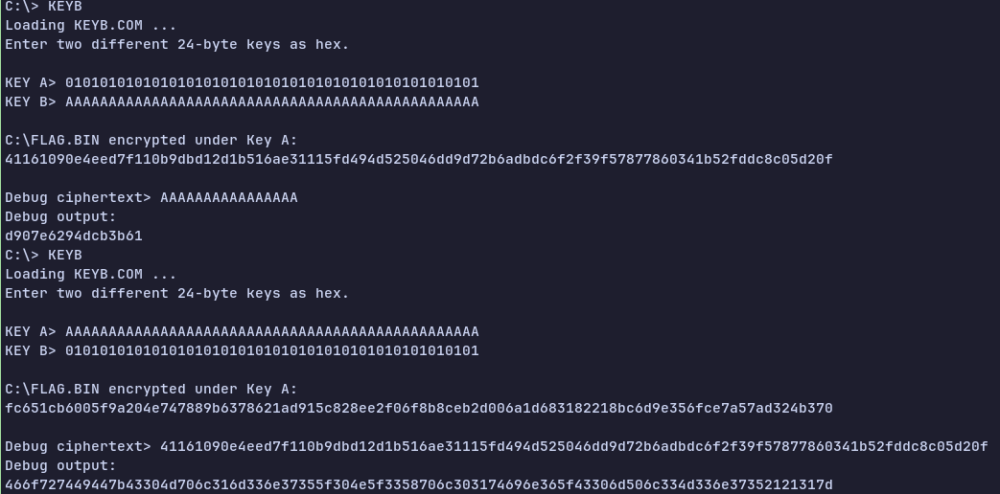

## Challenge

> I tried to install a famous MS-DOS emulator, but ended up installing this program.
>
> I don’t think this can run DOOM...

When we connect to the challenge, we see something imitating the well-known DOS emulator, DOSBox. We also see a directory listing, including a `FLAG.BIN`. Unfortunately, this is just a Python script emulating DOSBox, so we can't just read the file.

Running `KEYB` allows us to enter 2 keys. The program encrypts the flag using the first key, and encrypts "debug ciphertext" that we provide using the second key.

## Recon

When we look through the provided `DESBox.py`, we find that the encryption used is (as the challenge names suggests), "Data Encryption Standard", or DES for short. More specfically, 3DES, which essentially runs DES 3 times back-to-back. Googling "DES exploit" quickly leads us to find that it has "weak keys" - certain keys that result in encryption and decryption being equivalent, i.e., encrypting the ciphertext gives us the plaintext back.

The Python script has some checks on the 2 keys so that we can't use 2 weak keys together, but there's nothing preventing us from just running `KEYB` twice :p

Wikipedia has a convenient [list of DES weak keys](https://en.wikipedia.org/wiki/Weak_key#Weak_keys_in_DES).

## Exploit

1. Pick any weak key. I used `010101010101010101010101010101010101010101010101` (`01` \* 24)
2. Run `KEYB`, entering the weak key as the 1st key. The 2nd key and debug ciphertext don't matter.
3. Run `KEYB` again, entering the weak key as the 2nd key, and our encrypted flag as the debug cipher text. The 1st key doesn't matter. Convert the resulting "debug ciphertext" from hex back into ASCII, and boom! There's our flag!

## Flag

`FortID{C0Mpl1m3n75_0N_3Xpl01tin6_C0mPl3M3n75!!1}`
