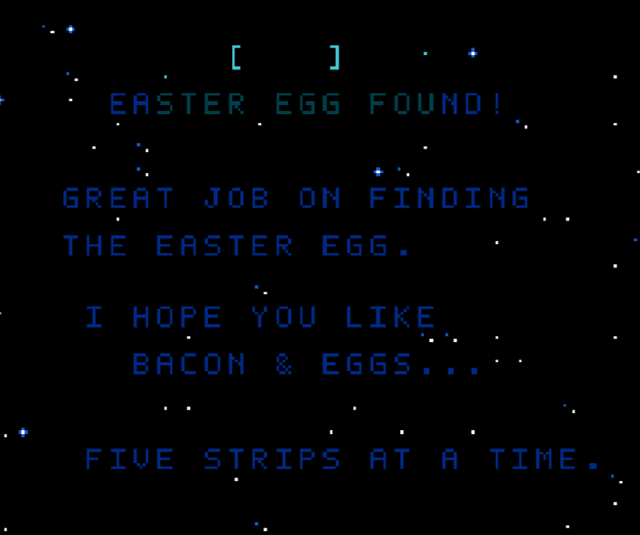

## Challenge

We are given a NES ROM:

```text
$ file meteor_shower.nes
meteor_shower.nes: NES ROM image (iNES): 2x16k PRG, 1x8k CHR [H-mirror]
```

Running it in [Mesen](https://www.mesen.ca/) shows a simple dodge-the-meteors game. Beating it only gives a "Mission Complete" screen, so the flag is hidden somewhere else in the code.

## Recon

I loaded the ROM into Ghidra with the NES loader plugin. With two 16 KB PRG banks, the PRG ROM is mapped at `$8000`, and execution starts at the `reset` vector.

The joypad is memory-mapped at `$4016`, so the routine reading it is easy to find (`$80C1`):

```c
void read_joypad(void)
{
  byte prev = joy_held;
  joy_prev = joy_held;
  JOY1 = 1;               // strobe the controller
  JOY1 = 0;
  joy_held = 0;
  for (byte i = 0; i != 8; i++) {
    if (JOY1 & 1)
      joy_held |= button_bits[i];
  }
  joy_new = ~prev & joy_held;   // buttons pressed this frame
}
```

The button masks are `A = 0x01`, `B = 0x02`. Most uses of `joy_held` are player movement, but the routine at `$80EF` is different.

## The hidden input

`$80EF` runs every frame in every game state except `4`, so it also runs on the title screen. It records each A/B press as one bit (A = `0`, B = `1`) into a buffer at `$0400`, most significant bit first. After 95 (`0x5F`) presses it calls a check, and on success it moves the game to state `4`:

```c
void record_code_input(void)
{
  if (game_state == 4 || (joy_new & 3) == 0)
    return;

  if ((joy_held & 3) == 1)      bit = 0;   // A
  else if ((joy_held & 3) == 2) bit = 1;   // B
  else return;

  if (bit)
    code_buf[code_byte] |= code_mask;
  code_mask >>= 1;
  if (code_mask == 0) {
    code_byte++;
    code_mask = 0x80;
  }

  if (++code_count == 0x5F) {
    if (check_secret_code()) {   // returns its result in the carry flag
      game_state = 4;
      redraw_req = 5;
      return;
    }
    reset_code_buf();
  }
}
```

Ghidra's output here is a bit misleading: `check_secret_code` returns its result in the carry flag (`SEC` on success, `BCC` after the call), which the decompiler shows as a comparison on `code_count`. A wrong sequence just clears the buffer.

The check (`$8158`):

```c
bool check_secret_code(void)
{
  byte bad = 0;
  byte idx = 0x0B;
  for (byte i = 0; i != 0x5F; i++) {
    byte bit = (code_buf[i >> 3] & bit_masks[i & 7]) != 0;
    bad |= ((meteor_x_tbl[idx] ^ meteor_speed_tbl[idx] ^ i) & 1) ^ bit;
    idx = (idx + 0x25) & 0x7F;
  }
  return bad == 0;
}
```

Input bit `i` has to equal `(meteor_x_tbl[idx] ^ meteor_speed_tbl[idx] ^ i) & 1`. The two key tables at `$8718` and `$8798` are the game's own meteor spawn X and speed tables, 128 bytes each. Since the check uses only ROM data, we can compute the expected sequence directly.

## Solve

```python
rom = open("meteor_shower.nes", "rb").read()

def prg(addr, size):
    # 16-byte iNES header, PRG ROM mapped at $8000
    off = 0x10 + (addr - 0x8000)
    return rom[off:off + size]

meteor_x     = prg(0x8718, 0x80)
meteor_speed = prg(0x8798, 0x80)

bits = []
idx = 0x0B
for i in range(0x5F):
    bits.append((meteor_x[idx] ^ meteor_speed[idx] ^ i) & 1)
    idx = (idx + 0x25) & 0x7F

print("".join("AB"[b] for b in bits))
```

```text
BAABAAAABAABAAAAABAAABBABBAABBABAAAAAAAAABBBBABBBABAABBAABAAABBABBAABBABAAAAAAAAAABAABAABABAABB
```

Pressing this sequence on the title screen unlocks the secret screen:



"Bacon" and "five strips at a time" point to the [Bacon cipher](https://en.wikipedia.org/wiki/Bacon%27s_cipher). Each group of 5 presses is one letter (A = `0`, B = `1`, 26-letter alphabet), and 95 presses give 19 letters:

```python
print("".join(chr(ord("A") + int("".join(map(str, bits[i:i + 5])), 2))
              for i in range(0, len(bits), 5)))
```

```text
SCIENTIAPOTENTIAEST
```

*Scientia potentia est*, "knowledge is power".

Flag: `FortID{SCIENTIA_POTENTIA_EST}`
